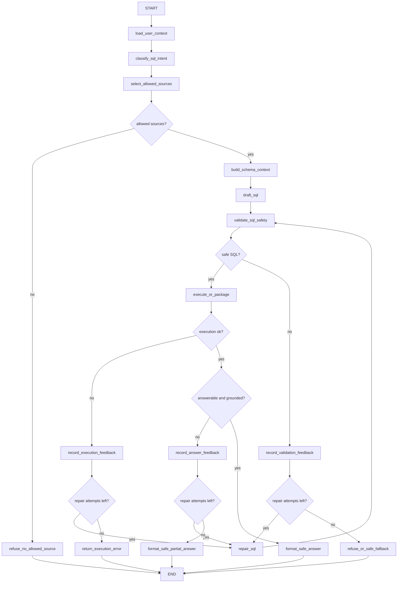

# SQL Subgraph Repair Loop Implementation Plan

## Current Issue

The pasted trace shows a linear SQL subgraph with weak recovery behavior:

1. `draft_sql` tried to use the OpenAI planner.
2. The planner failed with `BadRequestError`.
3. The graph silently fell back to a deterministic SQL template.
4. The fallback query selected internal columns: `requester_id` and `assigned_to`.
5. The trace printed raw user id, parameter values, raw SQL, and raw columns.
6. The final answer selected one ticket from a five-row result even though the user asked for ticket status generally.

So the actual design problem is not only the OpenAI error. The bigger issue is that the graph has no repair loop and no answer-grounding checkpoint:

- Planner failures are not repaired by the LLM.
- Validation failures are not sent back to the planner with feedback.
- DB execution errors are not sent back to the planner with feedback.
- Empty result sets are not checked against the user question.
- Final answers are not required to account for all relevant returned rows.
- Debug traces can expose internal fields if the old CLI path is used.

The latest local code already adds output sanitization and hides/sanitizes trace by default, but the graph still needs a proper repair loop before we treat the SQL subgraph as production-shaped.

## LangGraph/LangChain Docs Context

Relevant docs reviewed:

- LangChain SQL agent: `https://docs.langchain.com/oss/python/langchain/sql-agent`
- LangGraph custom SQL agent: `https://docs.langchain.com/oss/python/langgraph/sql-agent`
- LangGraph graph loops: `https://docs.langchain.com/oss/python/langgraph/use-graph-api#create-and-control-loops`
- Thinking in LangGraph: `https://docs.langchain.com/oss/python/langgraph/thinking-in-langgraph`
- LangGraph fault tolerance: `https://docs.langchain.com/oss/python/langgraph/fault-tolerance`

The key pattern from the SQL docs is:

```text
generate query -> check query -> execute query -> send result or error back -> generate again
```

The custom LangGraph SQL agent implements dedicated nodes for query generation, query checking, and query execution. It routes back from execution to query generation so the model can correct errors.

The graph loop docs say loops should have explicit termination conditions, usually through conditional edges, and should also use recursion limits as a safety net.

Thinking in LangGraph recommends different recovery strategies:

- Transient errors: retry policy.
- LLM-recoverable errors: store error in state and loop back.
- User-fixable errors: pause or ask for clarification.
- Unexpected errors: surface them instead of hiding them.

For NexusOne, we should use the same loop idea, but we must keep permission checks and SQL validation deterministic.

## Recommended Graph Shape



## Node Responsibilities

### 1. `load_user_context`

Loads the trusted user context from Postgres.

Rules:

- The authenticated `user_id` from runtime is trusted.
- Model output must never override runtime `user_id`.
- If the user is inactive or missing, stop with refusal.

### 2. `classify_sql_intent`

Determines the structured-data intent.

Rules:

- Use OpenAI if enabled.
- Fall back to deterministic classification only for known safe intents.
- Store classifier confidence and reason in state.
- Do not execute SQL from this node.

### 3. `select_allowed_sources`

Chooses sources by user role, groups, department, and intent.

Rules:

- Deterministic code only.
- No prompt-based permissions.
- If no source is allowed, stop before schema context generation.

### 4. `build_schema_context`

Builds a compact schema prompt using only safe source definitions.

Rules:

- Do not expose raw database schema.
- Do not expose hidden columns such as `requester_id`, `assigned_to`, `actor_user_id`, `manager_id`, `owner`, `source_path`, or `confidentiality`.
- Prefer safe views/functions over raw tables.

### 5. `draft_sql`

Produces first candidate SQL and parameters.

Rules:

- Use only allowlisted source names.
- Use only named parameters.
- Never accept model-provided `user_id`; always overwrite it with runtime `state.user_id`.
- Prefer task-specific query shape. Example: if a ticket id appears in the question, add `WHERE ticket_id = :ticket_id`.

### 6. `validate_sql_safety`

Validates before execution.

Checks:

- One statement only.
- `SELECT`/safe `WITH` only.
- No DML/DDL.
- Only allowlisted sources.
- Required user-scoped functions include `:user_id`.
- Row limit is present and within source max rows.
- Selected columns are safe for the intent/domain.

Output:

- `validation.is_safe`
- `validation.reason`
- `validation.feedback_for_repair`
- `validation.used_sources`
- `validation.sql_to_execute`

### 7. `record_validation_feedback`

Stores validator feedback in state.

Examples:

- "Query selected hidden column `assigned_to`; use safe ticket columns only."
- "Query referenced non-allowlisted table `tickets`; use `accessible_tickets(:user_id)`."
- "Query is missing `:user_id`."

### 8. `repair_sql`

Asks the planner to rewrite SQL using:

- Original user question.
- Intent.
- Safe schema context.
- Previous SQL.
- Validation or DB error feedback.
- Attempt count.

Rules:

- The prompt should say the prior query failed and must be repaired.
- The model sees feedback, not raw unrestricted DB schema.
- Runtime overwrites trusted parameters again after repair.

### 9. `execute_or_package`

Executes only after validation passes.

Rules:

- Read-only executor.
- Bound parameters only.
- Capture database errors as state feedback, not raw user-facing output.
- Do not expose raw rows directly to final answer.

### 10. `record_execution_feedback`

Stores DB error feedback for repair.

Examples:

- Unknown column.
- Wrong function call.
- Type mismatch.
- Empty result when the question included a specific entity that should be checked.

### 11. `check_answer_grounding`

Checks whether the query result supports a direct answer.

Rules:

- If the user asks "show my ticket status" and five rows return, final answer should summarize all five, not pick one arbitrary row.
- If the user asks for a specific ticket and zero rows return, answer should say no accessible matching ticket was found.
- If the query returned hidden columns, the final payload must still be sanitized before the answer model sees it.
- If rows are empty but the generated SQL looks too narrow, send feedback to repair once.

### 12. `format_safe_answer`

Final user-facing answer.

Rules:

- Use `presentation.py` sanitization.
- Do not mention raw user ids, assignee ids, requester ids, actor ids, SQL, parameter values, source paths, or confidentiality labels.
- Answer only the asked question.
- Account for all relevant rows.

## State Additions

Add these fields to `SQLSubgraphState`:

```python
repair_attempts: int = 0
max_repair_attempts: int = 2
planner_error: str | None = None
validation_feedback: str | None = None
execution_feedback: str | None = None
answer_feedback: str | None = None
repair_history: tuple[Mapping[str, Any], ...] = ()
final_answer_grounded: bool = False
```

Add these fields to output or trace where useful:

```python
repair_attempt_count: int
repair_reasons: tuple[str, ...]
```

Trace output must show only sanitized repair reasons and counts, not raw SQL or parameter values.

## Routing Rules

### After `validate_sql_safety`

```text
if safe:
    execute_or_package
elif repair_attempts < max_repair_attempts and validation is repairable:
    record_validation_feedback -> repair_sql
else:
    refuse_or_safe_fallback
```

### After `execute_or_package`

```text
if execution error and repair_attempts < max_repair_attempts:
    record_execution_feedback -> repair_sql
elif execution error:
    return safe error
elif execution ok:
    check_answer_grounding
```

### After `check_answer_grounding`

```text
if grounded:
    format_safe_answer
elif repair_attempts < max_repair_attempts:
    record_answer_feedback -> repair_sql
else:
    format_safe_partial_answer
```

## Why This Over A Generic SQL Agent

Use a custom LangGraph subgraph, not a prebuilt SQL agent.

Reasons:

1. NexusOne permissions are data security rules, not prompt preferences.
2. The model must not see unrestricted schemas.
3. The model must not choose arbitrary tables.
4. Validation must happen before every execution, including repairs.
5. Final answer sanitization must happen regardless of the query result.
6. The SQL tool needs to be usable as an independent subgraph now and as a tool/subgraph inside the future main NexusOne graph later.

## Implementation Phases

### Phase 1: Make Current Graph Loop-Capable

- Add repair fields to `SQLSubgraphState`.
- Add `repair_sql` node.
- Add feedback recording helpers.
- Add routing helpers:
  - `route_after_validation`
  - `route_after_execution`
  - `route_after_grounding`
- Keep deterministic runner compatibility.

### Phase 2: Add Planner Repair API

Extend `SQLPlanner` with:

```python
def repair_sql(
    self,
    question: str,
    intent: str,
    schema_context: str,
    allowed_sources: tuple[SourceDefinition, ...],
    previous_sql: str | None,
    previous_parameters: Mapping[str, Any],
    feedback: str,
    user_id: str,
) -> tuple[str, Mapping[str, Any]]:
    ...
```

For deterministic mode, implement a simple safe repair:

- If hidden columns are selected, remove them.
- If ticket id is present, use exact ticket template.
- If required `:user_id` is missing, use safe function template.

### Phase 3: Harden Validator

Add column-level validation:

- Parse selected columns where practical.
- Reject `SELECT *`.
- Reject hidden columns.
- Reject output columns not allowed by the source domain.

Keep this deterministic. The model can propose SQL, but code decides if it can execute.

### Phase 4: Add Answer Grounding

Implement `check_answer_grounding`:

- For single ticket question: require at most one returned row.
- For broad ticket status question: require the answer payload to include all returned ticket rows.
- For empty results: decide whether the result is a valid "not found" answer or a too-narrow query needing repair.

### Phase 5: Update CLI Trace

Trace should include:

- node name
- status
- intent
- allowed source names
- parameter keys only
- repair attempt count
- repair reason category
- row count

Trace should not include:

- raw user id
- raw SQL
- parameter values
- hidden columns
- raw DB errors if they contain SQL text

### Phase 6: Tests

Add unit tests:

- Planner `BadRequestError` routes to deterministic fallback or repair safely.
- Planner cannot override `user_id`.
- Validator rejects hidden columns.
- Validator rejects `SELECT *`.
- Repair loop removes `assigned_to` and `requester_id`.
- Repair loop stops after max attempts.
- Empty specific-ticket result answers "not found" rather than inventing.
- Broad ticket-status result answers all rows.
- CLI trace hides raw SQL and parameter values.

Add live checks:

```bash
./venv/bin/python scripts/sql_subgraph_chatbot.py --user-id u001
```

Questions:

- `Show my ticket status.`
- `Show ticket IT-1046 status.`
- `Who is assigned to IT-1046?`
- `Show requester and assignee for my tickets.`
- `Show all tickets from the tickets table.`
- `Show department budget utilization.`

Expected:

- Employee can see allowed ticket status only.
- Raw assignee/requester IDs are not shown.
- Raw table access is refused.
- Finance data is refused for employee.
- Trace is sanitized.

## Success Criteria

We can move on when:

1. SQL planning errors do not silently produce unsafe output.
2. Validation errors loop back for repair up to a fixed limit.
3. DB execution errors loop back for repair up to a fixed limit.
4. Empty results are handled intentionally.
5. Final answers are grounded in sanitized rows.
6. Debug traces are sanitized.
7. Unit tests cover repair, validation, sanitization, and grounding.
8. Live Postgres checks pass for employee, finance, manager, executive, and CEO users.

